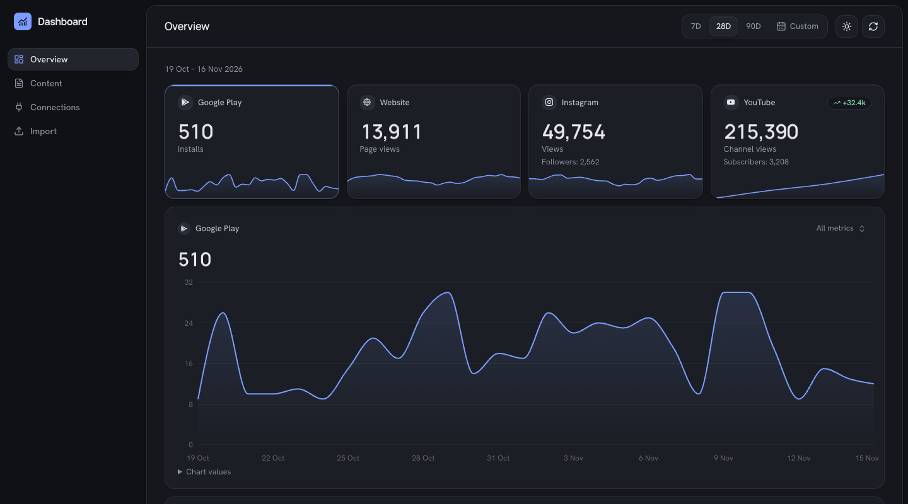

# oss-dashboard

A self-hosted analytics dashboard for a small creator or product team. It collects your own numbers from the
places you publish (website, YouTube, TikTok, Instagram, Facebook, App Store, GitHub) into one SQLite database and
shows them as trend tiles, charts, a per-post content view and a CSV-exportable ledger.



It runs as a single Cloudflare Worker with D1, either on Cloudflare or on your own machine through `workerd`
(the open-source Workers runtime). No external services are needed beyond the ones you choose to connect.

It is built to be changed by coding agents. [AGENTS.md](AGENTS.md) is the entry point for Claude Code, Codex,
Cursor and friends, and [docs/CUSTOMIZING.md](docs/CUSTOMIZING.md) has recipes for new sources, tiles, components
and themes. Describe what you want; the agent has what it needs to build it.

> **There is no built-in sign-in.** The original private version of this project ran behind
> **Cloudflare Access** for sign-in (Google login, exact email allowlist), and the Worker also verified the Access
> JWT. That code is removed here so you can choose your own front door. Anyone who can reach the URL can read your
> analytics and connect or disconnect accounts, so put something in front of it. See [Protect it](#protect-it).

## Quick start (local, 2 minutes)

Requires Node 22.18 or later.

```sh
npm ci
npm run selfhost        # builds the UI, creates ./data, runs on http://localhost:8787
```

Open http://localhost:8787. Import [docs/sample-import.json](docs/sample-import.json) from the Import tab to see
it with data. Settings go in `.dev.vars` (copy [.env.example](.env.example)); every source is optional.

## Host it yourself

### Docker

```sh
cp .env.example .env     # fill in what you use; leave the rest empty
docker compose up -d     # http://localhost:8787, data in ./data
```

The container runs `workerd` with a local D1 (SQLite) database in `./data` and a built-in scheduler that fires the
same hourly and daily syncs Cloudflare would. A `TOKEN_ENCRYPTION_KEY` is generated on first start and kept in
`./data/token-encryption-key`. **Back up `./data` as a whole**: the database is useless without that key.

Compose binds to `127.0.0.1` on purpose. To reach it from other devices, use a private network (Tailscale,
WireGuard) or an authenticating reverse proxy, as in [Protect it](#protect-it).

### Without Docker

`npm run selfhost` does the same thing natively. Use `HOST=0.0.0.0 PORT=8787 DATA_DIR=/srv/dashboard` to change
where it listens and stores data, and a process manager (systemd, pm2) to keep it running.

## Host it on Cloudflare

Free plan works for light use; Workers Paid ($5/month) removes the subrequest limits that matter if you connect
many sources.

```sh
npm ci
npx wrangler login
npm run setup:cloudflare                                   # on <name>.<you>.workers.dev
npm run setup:cloudflare -- --domain dash.example.com      # or on your own domain (zone must be on Cloudflare)
npm run setup:cloudflare -- --secrets .env.production      # also upload settings from a dotenv file
```

The setup script creates the D1 database, writes the git-ignored `wrangler.production.json`, applies migrations,
deploys, and generates `TOKEN_ENCRYPTION_KEY` if it does not exist. It is safe to re-run. Later releases:
`npm run deploy` (runs the full test suite first).

Once this repository is public, the button below should also work. Cloudflare's deploy button is meant to fork the repo,
provision D1 and deploy. This path has not been tested yet.
Add `TOKEN_ENCRYPTION_KEY` (from `openssl rand -base64 32`) as a secret afterwards, then apply migrations with
`npm run db:production` or the D1 console.

[](https://deploy.workers.cloudflare.com/?url=https://github.com/immanuel-lam/oss-dashboard)

## Protect it

Pick one. All of them take a few minutes.

- **Cloudflare Access (recommended on Cloudflare, free up to 50 users).** This is what the original project used.
  - workers.dev: Workers & Pages → oss-dashboard → Settings → Domains & Routes → workers.dev → *Enable Cloudflare
    Access*. Then edit the policy to allow only your email.
  - Custom domain: Zero Trust → Access → Applications → Add → Self-hosted. Application domain: your dashboard host,
    all paths. Policy: *Allow*, *Emails*, your address. Login methods: *One-time PIN* (no setup) or Google.
  - Access also protects a self-hosted box through a Cloudflare Tunnel (`cloudflared`).
- **Private network.** Keep the default `127.0.0.1` binding and reach it over Tailscale or WireGuard.
- **Reverse proxy with auth.** Caddy `basic_auth`, oauth2-proxy, Authelia or Authentik in front of port 8787.

Behind a proxy or tunnel, set `PUBLIC_URL` to the public `https://` address. OAuth callbacks need HTTPS on a stable host name, so connected social accounts work best on Cloudflare or behind a
proxy with a real certificate. Imports, website analytics, GitHub and Apple work fine on plain localhost.

## What it collects

| Source | How | Settings |
| --- | --- | --- |
| Website | Cloudflare Web Analytics (preferred) or PostHog | `CLOUDFLARE_ANALYTICS_*` or `POSTHOG_*`, `SITE_HOSTNAMES` |
| YouTube | OAuth: daily views, watch time, subscribers; hourly video totals | `YOUTUBE_CLIENT_ID/SECRET` |
| TikTok | OAuth (Display API): followers, likes, per-video lifetime views | `TIKTOK_CLIENT_ID/SECRET` |
| Instagram | Meta system-user token (richer) or OAuth | `INSTAGRAM_ACCESS_TOKEN` + `INSTAGRAM_USER_ID` |
| Facebook Page | Meta system-user token (richer) or OAuth | `FACEBOOK_ACCESS_TOKEN` + `FACEBOOK_PAGE_ID` |
| App Store | App Store Connect Analytics Reports, Sales and Trends, chart rank | `APPLE_*`, `APP_STORE_COUNTRY`, `APP_STORE_GENRES` |
| GitHub | Commits and pull requests per day | `GITHUB_TOKEN`, `GITHUB_REPOS` |
| Google Play / anything else | JSON import (Import tab, or `POST /api/import`) | — |

Provider setup (scopes, callback URLs, where to find each ID) is in [DEPLOYMENT.md](DEPLOYMENT.md). Every setting is
listed with a comment in [.env.example](.env.example).

### Data rules

These are deliberate and the tests enforce them: unavailable data is never shown as zero; account snapshots
(followers, lifetime views) are never summed across days; provider dates and time zones are kept as reported;
website sources are never added together; and there is no made-up cross-platform "unique audience".

## Build a mobile app on top

The UI is a client of a small JSON API. [docs/API.md](docs/API.md) documents every endpoint and the shape of
`GET /api/metrics`, which is everything the dashboard shows. A native app (Android, iOS, a widget) only needs that
endpoint. If you put Cloudflare Access in front, use an Access service token for the app.

## Develop

```sh
npm run dev        # Worker + local D1 on http://localhost:8787 (rebuild UI with npm run web:build)
npm run web:dev    # Vite with hot reload on :5173, proxying /api to npm run dev
npm run verify     # types, tests, UI build and a Worker dry-run bundle — run before every PR
```

Stack: TypeScript Worker (`src/`), React 19 + Tailwind 4 + shadcn/ui + Recharts (`web/`), D1/SQLite (`migrations/`),
`node:test` (`tests/`).

## License

MIT. See [LICENSE](LICENSE). Brand icons are from Simple Icons (CC0). Manrope and Hanken Grotesk are under the SIL
Open Font License.
